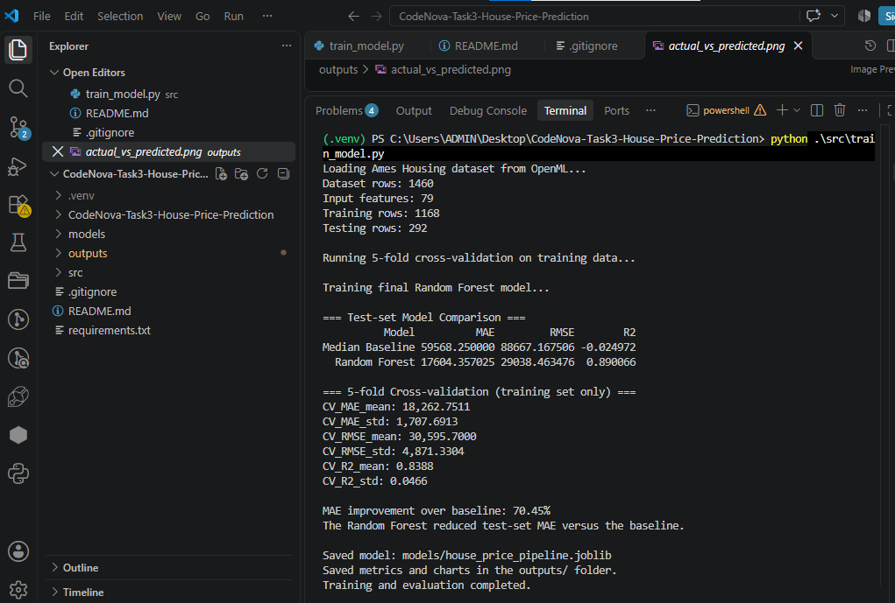

# CodeNova Task 3: House Price Prediction

## Project Overview

This project predicts residential house sale prices using machine learning regression techniques. It uses the Ames Housing dataset and compares a median-price baseline with a Random Forest regression model.

The project demonstrates data preprocessing, feature engineering, cross-validation, model evaluation, and visualization while avoiding target leakage.

## Objectives

- Predict house sale prices using property characteristics.
- Handle missing numerical and categorical values.
- Encode categorical features and scale numerical features.
- Compare a machine learning model against a simple baseline.
- Evaluate performance using MAE, RMSE, and R².
- Visualize predictions, residuals, and feature importance.
- Document assumptions, limitations, and potential failure cases.

## Dataset and Attribution

This project uses the Ames Housing dataset retrieved through scikit-learn's `fetch_openml` function.

- **Dataset:** `house_prices`, version 1
- **Access method:** OpenML through scikit-learn
- **Source:** [OpenML dataset search](https://www.openml.org/search?type=data&status=active&id=42165)

The dataset is used for educational machine learning experimentation. Please consult the exact dataset record and its applicable license or terms before redistributing the original data.

The original dataset is not intentionally included in this repository. Dataset access may require an internet connection.

## Technologies Used

- Python
- pandas and NumPy
- scikit-learn
- Matplotlib
- joblib

## Methodology

### 1. Data splitting

The dataset is split into:
- 80% training data
- 20% held-out test data

A fixed random seed of 42 makes the split reproducible.

### 2. Preprocessing

A scikit-learn `ColumnTransformer` applies separate preprocessing pipelines:

**Numerical features**
- Missing values filled with the training-fold median.
- Features standardized using `StandardScaler`.

**Categorical features**
- Missing values filled with the most frequent training-fold value.
- Categories encoded using `OneHotEncoder(handle_unknown="ignore")`.

Preprocessing is included inside the model pipeline. It is fitted only on training data during model fitting and separately within each cross-validation fold. The held-out test set is not used to fit preprocessing or select model parameters.

### 3. Models

**Baseline:** `DummyRegressor(strategy="median")`, which predicts the median training price for every house.

**Machine learning model:** `RandomForestRegressor` with 200 trees, `min_samples_leaf=2`, and random state 42.

### 4. Cross-validation

Five-fold cross-validation is performed on the training data. The test set remains held out until final evaluation.

### 5. Evaluation metrics

- **MAE:** Mean Absolute Error; lower is better.
- **RMSE:** Root Mean Squared Error; lower is better and larger errors are penalized more heavily.
- **R²:** Coefficient of determination; higher is generally better.

## Results

### Held-out test set

| Model | MAE | RMSE | R² |
|---|---:|---:|---:|
| Median Baseline | $59,568.25 | $88,667.17 | -0.0250 |
| Random Forest | $17,604.36 | $29,038.46 | 0.8901 |

The Random Forest reduced test-set MAE by approximately **70.4%** compared with the median baseline.

### Five-fold cross-validation

| Metric | Mean | Standard Deviation |
|---|---:|---:|
| MAE | $18,262.75 | $1,707.69 |
| RMSE | $30,595.70 | $4,871.33 |
| R² | 0.8388 | 0.0466 |

These values come from cross-validation on the training split. Test-set metrics are reported separately.

## Evaluation Charts

The script generates the following charts in the `outputs/` directory:

- `actual_vs_predicted.png` — compares actual and predicted sale prices.
- `residual_plot.png` — helps identify systematic prediction errors.
- `feature_importance.png` — displays the 15 features with the highest Random Forest importance scores.

Feature importance indicates model associations, not causation.

## Project Structure

```text
CodeNova-Task3-House-Price-Prediction/
├── src/
│   └── train_model.py
├── outputs/
│   ├── actual_vs_predicted.png
│   ├── residual_plot.png
│   ├── feature_importance.png
│   ├── feature_importance.csv
│   ├── model_metrics.csv
│   ├── cross_validation_metrics.csv
│   └── test_predictions.csv
├── models/
│   └── house_price_pipeline.joblib
├── requirements.txt
└── README.md
```

## How to Run

### 1. Clone the repository

```bash
git clone https://github.com/anjaliyama4/CodeNova-Task3-House-Price-Prediction.git
cd CodeNova-Task3-House-Price-Prediction
```

Replace `YOUR-USERNAME` with your GitHub username.

### 2. Install dependencies

It is recommended to use a virtual environment.

```bash
python -m venv .venv
```

Activate it on Windows PowerShell:

```powershell
.\.venv\Scripts\Activate.ps1
```

Install the required libraries:

```bash
python -m pip install -r requirements.txt
```

### 3. Train and evaluate

```bash
python src/train_model.py
```

The dataset is downloaded from OpenML if it is not already cached. The script trains the model, evaluates the held-out test set, saves the trained pipeline, and generates the evaluation files and charts.

## Limitations and Failure Cases

- The dataset represents homes from Ames, Iowa; performance may not generalize to other cities, countries, or housing markets.
- The dataset reflects a particular period and may not represent current market prices.
- Unusual properties, luxury homes, and rare combinations of features may produce larger errors.
- Missing-value imputation can lose information about why a value is missing.
- One-hot encoding can create a large number of features for high-cardinality categorical columns.
- Random Forest predictions do not necessarily extrapolate well beyond price ranges represented in the training data.
- Feature importance does not establish causal relationships.
- The test set contains only 292 houses, so results may vary with a different split.
- The median baseline is deliberately simple; comparisons against tuned linear regression, Ridge, or gradient boosting models would provide a broader benchmark.
- MAE and RMSE are expressed in the dataset's sale-price units, which are US dollars. They should not be interpreted as guarantees for individual predictions.

## Assumptions

- Historical property characteristics contain useful information about sale prices.
- Training and future observations are sufficiently similar for the model to be useful.
- The dataset's recorded sale prices and features are reasonably accurate.
- Evaluation data is representative of the intended prediction setting.

## Preventing Target Leakage

- `SalePrice` is used only as the target, not as an input feature.
- The identifier column is removed.
- The test split is created before model preprocessing is fitted.
- Imputation, scaling, and categorical encoding are fitted within the training pipeline.
- Cross-validation evaluates the entire pipeline on training folds.
- The held-out test set is used for final evaluation, not preprocessing or tuning.

## Future Improvements

- Compare Random Forest with Linear Regression, Ridge Regression, and Gradient Boosting.
- Tune hyperparameters using cross-validation.
- Examine prediction errors across price ranges and property types.
- Evaluate on a newer or geographically different dataset.
- Add a prediction interface for new property details.

## Conclusion

The Random Forest model substantially outperformed the median baseline on this held-out test split. The project demonstrates an end-to-end regression workflow with preprocessing, cross-validation, evaluation metrics, visualizations, and explicit leakage safeguards. Performance should be validated on new data before real-world use.

---

**Project:** CodeNova AI/ML Internship — Task 3  
**Topic:** House Price Prediction using Regression
## Execution Screenshot


